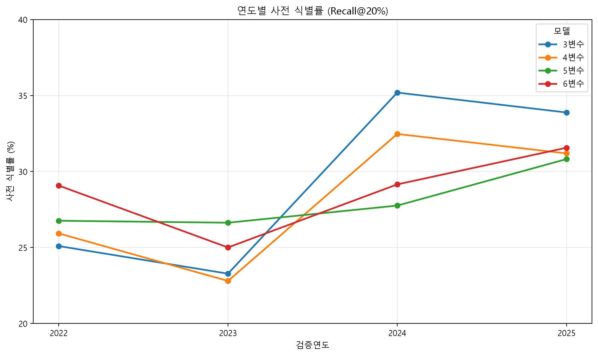

# 군수품 조달 유찰 KPI 연도별 순차 검증 및 패턴 안정성

## 검증 설계

| 학습 기간 | 검증 기간 |
|---|---|
| 2021~2021 | 2022 |
| 2021~2022 | 2023 |
| 2021~2023 | 2024 |
| 2021~2024 | 2025 |

공고일 기준 연도 분리, 결과확정 경쟁성 공고만 사용, 동일 기관그룹·조합 정의,
최소 10건 조건 완화, 위험도↓ → 근거공고수↓ → 공고키↑, 상위 20% 반올림(half-up).

## 1. 연도별 Recall@20% 비교

| 검증연도 | 3변수 | 4변수 | 5변수 | 6변수 | 연도 최고 조합 |
|---|---:|---:|---:|---:|---|
| 2022 | 25.09% | 25.93% | 26.76% | 29.07% | 6변수(기간+금액+분기) |
| 2023 | 23.28% | 22.80% | 26.63% | 25.00% | 5변수(기간+금액) |
| 2024 | 35.19% | 32.47% | 27.76% | 29.15% | 3변수 |
| 2025 | 33.88% | 31.19% | 30.82% | 31.56% | 3변수 |

## 2. 모델별 안정성 요약

| 모델 | 평균 식별률 | 최저 | 최고 | 연도간 범위 | 1위 연도수 | 평균 대체율 |
|---|---:|---:|---:|---:|---:|---:|
| 3변수 | 29.36% | 23.28% | 35.19% | 11.92%p | 2 | 0.66% |
| 4변수(기간) | 28.10% | 22.80% | 32.47% | 9.67%p | 0 | 1.95% |
| 5변수(기간+금액) | 27.99% | 26.63% | 30.82% | 4.19%p | 1 | 3.98% |
| 6변수(기간+금액+분기) | 28.70% | 25.00% | 31.56% | 6.56%p | 1 | 12.54% |

## 3. 해석상 주의

- 매년 검증 모집단·유찰 기저율·학습 공고 수가 다르므로 직접 비교한 성능 변화를 시장 변화나 모델 열화로 단정하지 않는다.
- 변수 추가가 매 연도 KPI를 높이는지, 1위 모델이 매년 동일한지, 최저 연도와 연도간 범위가 어떤지 함께 판단한다.
- 4개년 평균은 각 연도를 동일 가중한 단순 평균이다. 모집단 크기로 가중한 종합 성과가 아니다.
- 각 검증연도 정답은 해당 연도 점수 산정·정렬에 사용되지 않는다.
- 공고일로 학습 연도를 제한했지만 실제 결과 확정·공개일의 부재로 인한 시점 누수 위험은 남아 있다.
- 공고기간은 공고일~참가등록마감일로 계산되고, 금액 구간은 탐색적인 경계이므로 법정 기준으로 해석하지 않는다.
- 기관그룹 분류의 잠정성, 수의계약·미확인 결과 제외에 따른 선택 편향도 고려한다.

## 결과 파일

- `01_yearly_model_results.csv`: 연도별 4개 조합의 KPI 1·2, 대체율, 경계 동점 및 근거 표본.
- `02_pattern_summary.csv`: 각 모델의 4개년 평균·최저·최고·변동폭·1위 횟수.
- `03_pattern_report.md`: 본 보고서.
- `04_recall_trend.png`: 3~6변수 연도별 Recall@20% 선그래프.

## 연도별 성능 추이

- `execution.log`: 실행 로그.
